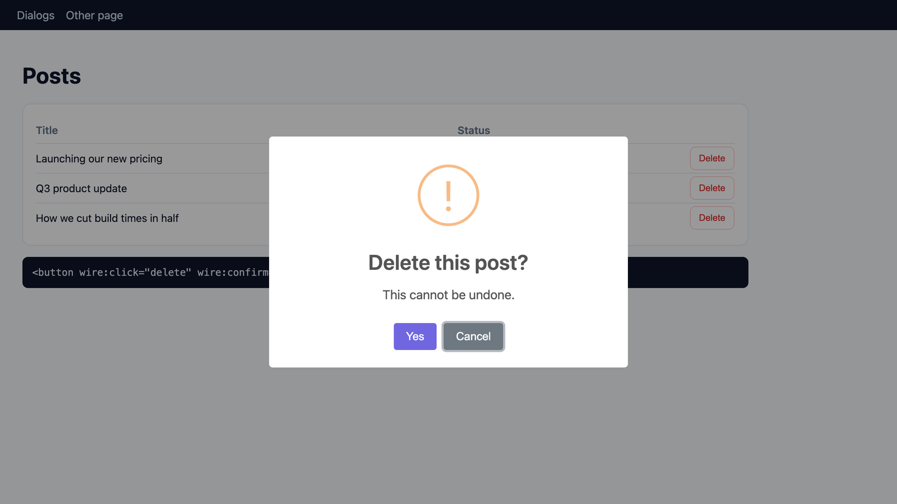

<p align="center">
  <picture>
    <source media="(prefers-color-scheme: dark)" srcset="art/banner-dark.png">
    
  </picture>
</p>

# Laravel SweetAlert2: popups, toasts and confirm dialogs for Laravel

Show [SweetAlert2](https://sweetalert2.github.io) popups and toast notifications from your Laravel controllers,
Livewire components and Alpine, and put a confirm dialog in front of any delete button with one data attribute.
SweetAlert2 11, no jQuery, no npm build step.

**Docs and demo:** [amjad.com.pk/laravel/packages/laravel-sweetalert2](https://amjad.com.pk/laravel/packages/laravel-sweetalert2)

[](https://packagist.org/packages/amjadiqbal/laravel-sweetalert2)
[](https://packagist.org/packages/amjadiqbal/laravel-sweetalert2)
[](LICENSE.md)

<p align="center">
  
</p>

```php
// In a controller
SweetAlert2::success('Invoice sent', 'We emailed it to the client.');

return redirect()->route('invoices.index');
```

```blade
{{-- Once, in your layout --}}
<x-sweetalert2 />

{{-- Anywhere: ask before deleting --}}
<button wire:click="delete({{ $invoice->id }})" data-swal-confirm="Delete this invoice?">Delete</button>
```

## Why this package

SweetAlert2 is the most used popup library on npm (about half a million downloads a week). This package keeps
the Laravel side small and safe:

- **Flash popups like flash messages.** Queue one or several from a controller; they show, one after another,
  on the next page, even after more than one redirect.
- **Livewire's `wire:confirm`, styled, with zero markup changes.** Every existing `wire:confirm` and
  `wire:confirm.prompt` opens a SweetAlert2 dialog instead of the browser's grey `confirm()` box.
- **Await a dialog.** `await $swal.confirm('Publish?')` in Alpine, or `await LaravelSwal.prompt('Name?')` in plain
  JavaScript, returns the answer.
- **Confirm dialogs without JavaScript.** `data-swal-confirm` works on links, buttons, forms, Livewire
  `wire:click` and `wire:submit`.
- **Livewire and Alpine.** `$this->swal(...)` in a Livewire component, or `$dispatch('sweetalert2', {...})`
  in Alpine, shows a popup without a page load. Works with `wire:navigate`.
- **Safe by default.** Titles are rendered as text and button labels are escaped, so user input in a popup
  can't inject HTML. SweetAlert2 loads from a pinned jsDelivr URL with a Subresource Integrity hash, and
  every script tag carries Laravel's CSP nonce when you use one.

## Requirements

- PHP 8.3+
- Laravel 12 or 13
- SweetAlert2 11 (11.26.25 is loaded by default; nothing to install)
- Optional: Livewire 3.8+ or 4 (tested with 4.4.7) and Alpine.js

## Installation

```bash
composer require amjadiqbal/laravel-sweetalert2
```

Add the component once to your layout, just before `</body>`:

```blade
<x-sweetalert2 />
{{-- or: @sweetalert2 --}}
```

That's it. Optionally publish the config:

```bash
php artisan vendor:publish --tag=sweetalert2-config
```

## Usage

### From a controller (flashed to the next page)

```php
use AmjadIqbal\SweetAlert2\Facades\SweetAlert2;

SweetAlert2::success('Saved', 'Your profile is up to date.');
SweetAlert2::error('Payment failed', 'Your card was declined.');
SweetAlert2::warning('Almost full', 'You have used 90% of your storage.');
SweetAlert2::info('Heads up', 'Maintenance tonight at 22:00 UTC.');
SweetAlert2::question('Did you know?', 'You can drag files onto the page.');

SweetAlert2::toast('Copied to clipboard');            // small, top-right, closes itself
SweetAlert2::toast('Could not save', 'error');

// Or the helper
swal('Saved', 'Your profile is up to date.', 'success');
```

Every method returns a fluent builder; changes are saved automatically:

```php
SweetAlert2::success('Order placed', 'We will email you a receipt.')
    ->timer(4000)                 // auto-close, with a progress bar
    ->position('top')
    ->confirmButton('Great!')
    ->footer('Order #1042')
    ->theme('dark');

SweetAlert2::fire(['title' => 'Custom', 'icon' => 'info', 'allowOutsideClick' => false]);
```

Any [SweetAlert2 option](https://sweetalert2.github.io/#configuration) works through `option()`,
`options([...])` or `fire([...])`. Popups queued in one request show in order on the next page that renders
`<x-sweetalert2 />`, and only once.

### Confirm before an action

Add `data-swal-confirm` to a link, a button or a form. The action only runs if the user confirms.

```blade
<form method="POST" action="{{ route('posts.destroy', $post) }}" data-swal-confirm="Delete this post?"
      data-swal-text="This cannot be undone." data-swal-confirm-button="Yes, delete it">
    @csrf @method('DELETE')
    <button>Delete</button>
</form>

<a href="{{ route('logout') }}" data-swal-confirm="Sign out?" data-swal-icon="question">Sign out</a>

{{-- Livewire --}}
<button wire:click="archive" data-swal-confirm="Archive this project?">Archive</button>
```

| Attribute | Default (from `config('sweetalert2.confirm')`) |
|---|---|
| `data-swal-confirm` | The question (required) |
| `data-swal-text` | none |
| `data-swal-icon` | `warning` |
| `data-swal-confirm-button` | `Yes` |
| `data-swal-cancel-button` | `Cancel` |

### Livewire's `wire:confirm`, styled (no markup changes)

Installed, the package takes over Livewire's own [`wire:confirm`](https://livewire.laravel.com/docs/wire-confirm).
The markup you already have stays exactly as it is:

```blade
<button wire:click="delete" wire:confirm="Delete this post?\nThis cannot be undone.">Delete</button>

<button wire:click="wipe" wire:confirm.prompt="Type DELETE to wipe the workspace|DELETE">Wipe</button>
```

<p align="center">
  
</p>

| | Before (Livewire alone) | After (with this package) |
|---|---|---|
| `wire:confirm` | The browser's grey `confirm()` box, which can't be styled | A SweetAlert2 dialog: the first line is the title, the rest is the text, with the `confirm` settings from the config (icon, button labels, cancel focused) |
| `wire:confirm.prompt` | The browser's `prompt()` | A SweetAlert2 dialog with a text input; the action runs only if the typed text matches exactly |
| Empty `wire:confirm` | "Are you sure?" | "Are you sure?" |
| `\n` in the message | A line break | A line break |
| `.prompt` without `|expected` | Console warning, nothing happens | The same warning, nothing happens |
| Cancel / wrong text | The action doesn't run | The action doesn't run |

It works on `wire:click` and `wire:submit`, on elements Livewire adds later, and after `wire:navigate`.
It hooks into the `el.__livewire_confirm` callback that Livewire's `wire:confirm` directive defines; that
callback is the same in Livewire 3.8 and 4.4 (checked in their source). Tested in a real browser with Livewire 4.4.7.

To keep the browser's native box for one element, or for a whole section, add `data-swal-native`:

```blade
<button wire:click="delete" wire:confirm="Sure?" data-swal-native>Delete</button>
```

To turn it off everywhere, set `'livewire_confirm' => false` in `config/sweetalert2.php`. If SweetAlert2 hasn't
loaded, Livewire's native behaviour is used. Don't combine `wire:confirm` and `data-swal-confirm` on the same
element, or you'll be asked twice.

### Await a dialog (promise API)

Ask a question and get the answer back, like `confirm()` and `prompt()` but styled. In Alpine the `$swal` magic is
available in any `x-data`:

```blade
<button x-data @click="if (await $swal.confirm('Publish now?\nSubscribers get an email.')) $wire.publish()">
    Publish
</button>

<button x-data @click="let name = await $swal.prompt('Rename the project', 'Website'); if (name !== null) $wire.rename(name)">
    Rename
</button>

<button x-data @click="await $swal.alert({ title: 'Exported', icon: 'success' }); location.href = '/downloads'">
    Export
</button>
```

In plain JavaScript use `window.LaravelSwal`:

```js
if (await LaravelSwal.confirm('Leave without saving?')) {
    history.back();
}
```

| Method | Resolves to |
|---|---|
| `confirm(message, options?)` | `true` when confirmed, `false` when cancelled or dismissed |
| `prompt(message, defaultValueOrOptions?)` | the entered text, or `null` when cancelled (like `window.prompt`) |
| `alert(message, options?)` | nothing, once the dialog is closed |

`message` is a string (first line = title, the rest = text) or SweetAlert2 options. Messages are text, not HTML:
`title` is shown as text, button labels and `footer` are escaped, and line breaks are kept. Only an explicit `html`
option is inserted as HTML, so never put user input there. The dialogs use the `confirm` and `prompt` settings from
the config, SweetAlert2 keeps keyboard focus inside the dialog, and focus returns to the button afterwards.
TypeScript declarations are in `vendor/amjadiqbal/laravel-sweetalert2/resources/types/laravel-sweetalert2.d.ts`.

### From Livewire, without a page load

```php
use AmjadIqbal\SweetAlert2\Livewire\SweetAlerts;

class EditProfile extends Component
{
    use SweetAlerts;

    public function save(): void
    {
        // ...
        $this->swalToast('Profile saved');
        // or $this->swal('Saved', 'Your profile is up to date.', 'success');
        // or $this->swal(['title' => 'Saved', 'icon' => 'success', 'timer' => 2000]);
    }
}
```

Redirecting after the action instead? Use the facade; the popup shows on the page you redirect to, including
with `$this->redirect(..., navigate: true)`.

### From Alpine or plain JavaScript

```blade
<button x-data @click="$dispatch('sweetalert2', { title: 'Hello', icon: 'info' })">Say hello</button>
```

```js
window.LaravelSweetAlert2.toast({ title: 'Saved', icon: 'success' });
window.Swal.fire('Plain SweetAlert2 works too');
```

Options sent from the browser are passed to SweetAlert2 as they are, so don't put user input in `html`.

### HTML content

`title`, button labels and `footer` are escaped. For trusted HTML use `html()` or `raw()`, which pass values
through untouched; never put user input in them:

```php
SweetAlert2::info('Release notes')->html('<ul><li>Faster search</li><li>Dark mode</li></ul>');
```

## Configuration

`config/sweetalert2.php`:

```php
'assets' => [
    'cdn' => true,   // false if you bundle SweetAlert2 yourself
    'js' => 'https://cdn.jsdelivr.net/npm/sweetalert2@11.26.25/dist/sweetalert2.all.min.js',
    'js_integrity' => 'sha384-…',
],
'defaults' => [],           // applied to every popup, e.g. ['theme' => 'auto']
'toast' => [...],           // toast position, timer, progress bar
'confirm' => [...],         // data-swal-confirm, wire:confirm and $swal.confirm defaults
'prompt' => [...],          // wire:confirm.prompt and $swal.prompt defaults
'livewire_confirm' => true, // style Livewire's wire:confirm (false = browser's confirm())
```

**Bundling with Vite instead of the CDN:** set `'cdn' => false`, run `npm i sweetalert2`, and in
`resources/js/app.js`:

```js
import Swal from 'sweetalert2';
window.Swal = Swal;
```

**Content Security Policy:** with `Vite::useCspNonce()` every script tag gets the nonce. The SweetAlert2 "all"
build injects its CSS in a `<style>` tag, so a strict `style-src` needs `'unsafe-inline'` or the Vite setup
above with `import 'sweetalert2/dist/sweetalert2.css'` and the `sweetalert2.min.js` build.

**Themes:** `light`, `dark` and `auto` are built in (`->theme('auto')` or `'defaults' => ['theme' => 'auto']`).

## Upgrading from `amjadiqbal/sweetalert2`

That earlier package was never published. If you used a private copy: the Composer name is now
`amjadiqbal/laravel-sweetalert2`, the helper is `swal()` instead of `alert()`, `type` is now `icon`
(SweetAlert2 9+), and the layout include is `<x-sweetalert2 />` instead of `@include('sweetalert::alert')`.
See the [changelog](CHANGELOG.md).

## Testing

```bash
composer test
scripts/ci-local.sh   # every PHP 8.3–8.5 × Laravel 12/13 combination, Pint and PHPStan
```

## Need this built into your app, or something custom?

I build Livewire features, admin panels and Laravel packages for teams. If you'd rather have your app's
notifications and confirm flows designed and wired up for you, or need something this package doesn't do,
[get in touch](https://amjad.com.pk/contact?utm_source=github&utm_medium=readme&utm_campaign=laravel-sweetalert2).

## Support

- 🐛 **Bug or feature request**: [open an issue](https://github.com/amjadiqbal/laravel-sweetalert2/issues)
- 🔒 **Security issue**: please report privately via GitHub's security tab

## Need this customised, or something built?

I'm available for custom development, package integration, and technical consulting.

[](https://www.upwork.com/freelancers/amjadkhatri)

## More packages

Part of a family of open-source packages. See [all of them](https://github.com/amjadiqbal?tab=repositories).

| | |
|---|---|
| [laravel-driver-js](https://github.com/amjadiqbal/laravel-driver-js) | Driver.js product tours and onboarding for Laravel |
| [laravel-rough-notation](https://github.com/amjadiqbal/laravel-rough-notation) | Hand-drawn highlights and annotations for Blade |
| [laravel-tiptap](https://github.com/amjadiqbal/laravel-tiptap) | Tiptap editor for Laravel |
| [kiln](https://github.com/amjadiqbal/kiln) | Deploy-time OPcache control for Laravel |

## Credits

- [SweetAlert2](https://github.com/sweetalert2/sweetalert2) by Limon Monte and contributors (MIT), which does
  all the work in the browser. This package is an independent wrapper and is not affiliated with SweetAlert2.
- [Amjad Iqbal](https://amjad.com.pk)

## License

MIT. See [LICENSE.md](LICENSE.md).
